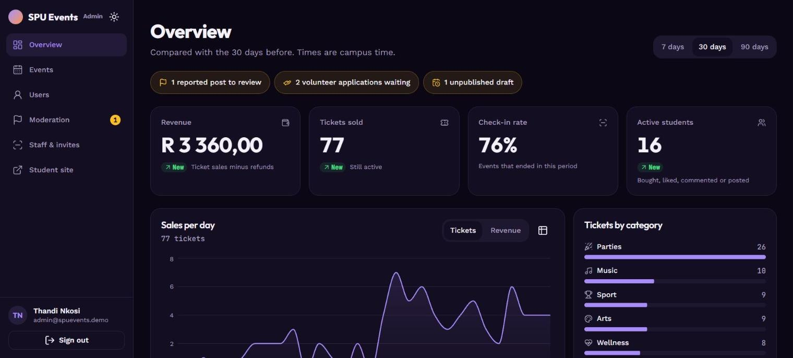
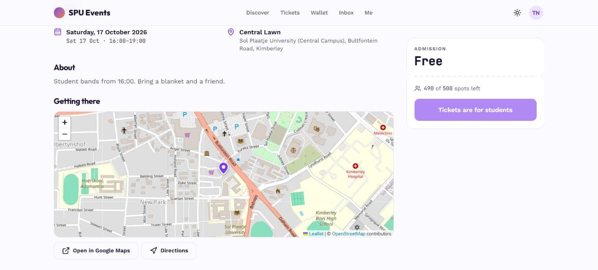
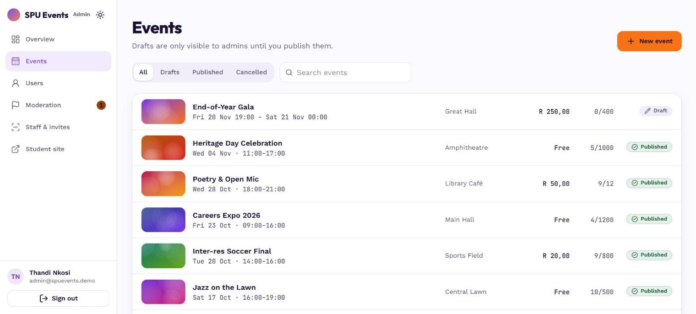
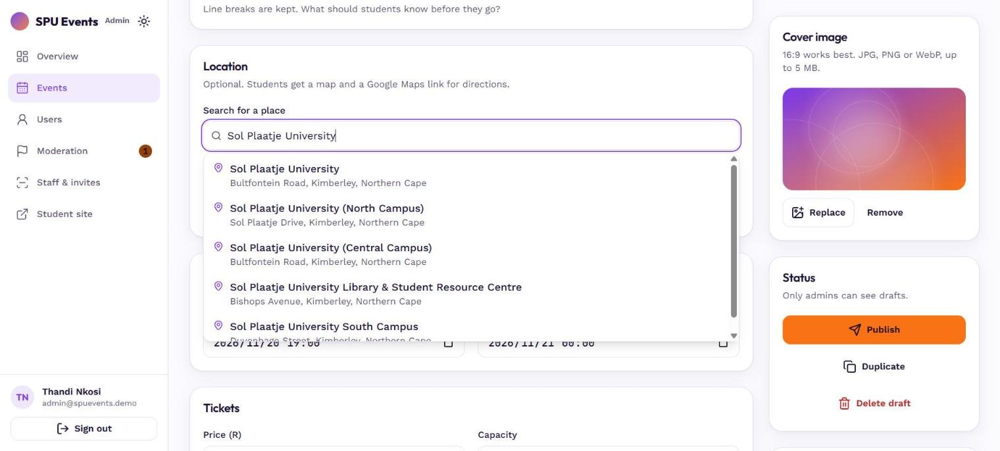
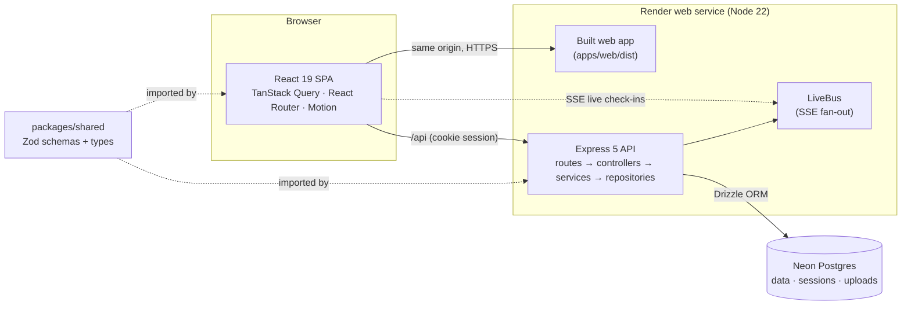

# SPU Events

Campus events for Sol Plaatje University students: discover events, pay from a campus wallet, get a signed QR ticket and walk through the gate with a scan. Organisers get a live dashboard, gate tools and moderation.

**Live demo:** https://spu-events.onrender.com (the free tier sleeps, so the first visit can take up to a minute)

| Role | Sign in with | Try |
|---|---|---|
| Student | `202312345` | Buy a ticket with the wallet, open the QR, comment, apply to volunteer |
| Gate staff | `gate@spuevents.demo` | Scan tickets with a phone camera (HTTPS), or type a ticket code |
| Admin | `admin@spuevents.demo` | Dashboard, create and publish events, moderation, users and wallet adjustments |

Demo passwords are shared on request.



| | |
|---|---|
|  |  |
| **Discover:** search and filters kept in the URL | **Getting there:** the venue on a map, with directions |
|  |  |
| **Events:** drafts, sales and status at a glance | **Location search:** suggestions near campus, then drag the pin |

## Features

**Students:** Discover with search and filters in the URL · event pages with a map of the venue and Google Maps directions · likes, threaded comments and reactions · a photo wall once an event starts · a wallet with top-ups, withdrawals and automatic refunds · QR tickets that also work offline · volunteer applications · an inbox for ticket, refund and moderation notices.

**Gate staff:** a phone-camera scanner with clear admit, already used, wrong event and cancelled results, plus a live check-in counter shared by every gate.

**Admins:** a dashboard (revenue net of refunds, tickets sold, check-in rate, active students, daily sales) · the event lifecycle (draft → published → cancelled, with refunds) · capacity limits that can't oversell · location search with suggestions and a draggable map pin · staff invites and gate assignments · a moderation queue · user management with an audit log · attendee CSV export.

## Engineering highlights

- **Double-use-proof check-in.** QR payloads are HMAC-signed. Check-in is a single conditional `UPDATE … WHERE status = 'valid'`, so two gates scanning the same ticket at once can't both admit it. A test races them to prove it.
- **Money as a ledger.** Integer cents in an append-only `wallet_ledger`, with the balance derived rather than stored. Purchases lock the event row, then the user row (in a fixed order, so there are no deadlocks). Top-ups and adjustments are idempotent through client request ids.
- **No overselling.** A real bug was found and fixed: under READ COMMITTED, a `SELECT … FOR UPDATE` that waited still saw its pre-wait snapshot in subqueries. Locks and reads are now separate statements, guarded by a concurrency test.
- **One schema, both sides.** Zod schemas in `packages/shared` validate API input and power the React forms, and the API's field errors land on the matching inputs.
- **Accessible by default.** axe-core finds zero violations on every student and admin page in both themes. Status colours are tuned for 4.5:1, charts have table views, touch targets are 44 px, and the app respects reduced motion.
- **Notifications and audit records in the same transaction** as the change they describe, so they can never disagree with the data.

## Architecture



| Layer | Choices |
|---|---|
| Web | React 19, Vite, Tailwind v4, shadcn-style components, TanStack Query, React Router 7, react-hook-form, Motion, Recharts, @zxing/browser |
| API | Express 5, TypeScript, Drizzle ORM (node-postgres), express-session + connect-pg-simple, argon2id, helmet, multer, pino |
| Data | PostgreSQL (Neon), drizzle-kit migrations |
| Quality | Vitest + Supertest integration tests against a real Postgres, Testing Library, ESLint, Prettier, GitHub Actions CI |
| Hosting | Render (one service serving the API and the web app) + Neon. See [docs/DEPLOYMENT.md](docs/DEPLOYMENT.md) |

```
apps/api        Express API (src/modules/<feature>/…), migrations in drizzle/
apps/web        React app (src/routes, src/components, src/lib)
packages/shared Zod schemas, types and money helpers used by both
docs/           redesign plan and deployment notes
```

## Run it locally

Requirements: Node 22.12 or later and PostgreSQL.

```sh
npm install
cp apps/api/.env.example apps/api/.env   # set DATABASE_URL and the two secrets
DEMO_PASSWORD=choose-one npm run db:setup -w @spu-events/api   # migrate and seed demo data
npm run dev                               # web on :5173, API on :4000
```

`npm test` runs every workspace. API tests need `TEST_DATABASE_URL` pointing at a separate database whose name contains "test", which they wipe. `npm run lint`, `npm run typecheck` and `npm run build` complete what CI checks.

## Known limits

- Payments are simulated behind a `PaymentProvider` interface. A real gateway (PayFast, Yoco) would plug in there.
- Invite links are shared by hand; there's no email delivery yet.
- Live check-ins fan out in-process, so the app runs as a single instance until the bus moves to Postgres `LISTEN/NOTIFY` or Redis.
